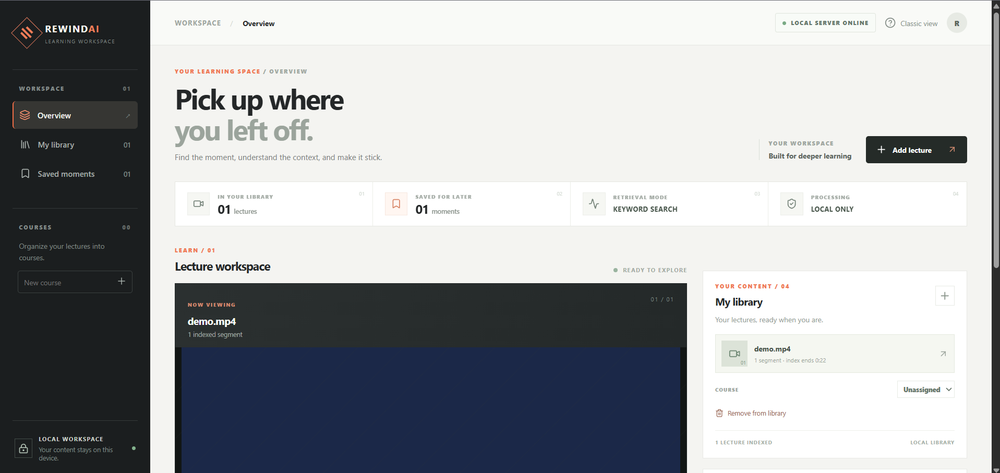
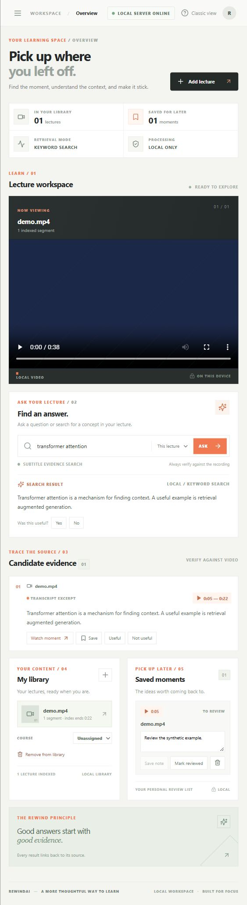

# RewindAI

**English** | [中文](README.zh-CN.md)

**Find it. Verify it. Learn it.**

I built RewindAI as a local AI learning workspace for finding and reviewing knowledge in lecture videos. I use Qwen3-Embedding for semantic retrieval, timestamped evidence for source verification, and a study workflow for saving clips and notes.

> **Project status:** Under development and evaluation. The CPU demo uses preset text and simplified retrieval; it does not demonstrate real video understanding. The full multimodal pipeline requires separate model setup and independent evaluation. The workspace is intended for local use and should not be deployed directly to the public internet.



*Workspace previews use synthetic demonstration content. No lecture recordings are included.*

<details>
<summary>View the narrow-screen workspace</summary>



</details>

## Get started: Windows

**You need:** Windows 10/11, Python 3.11 or newer, Node.js with npm, Git, internet for initial installation, and several GB of free disk space. The two main model files total approximately 2.7 GB; dependencies, the optional transcription model, and your own videos require additional space. The documented launcher uses CPU and can take time to load and answer.

1. Open PowerShell in the folder where you want the project and run:

   ```powershell
   git clone https://github.com/laizhen1/RewindAI.git
   cd RewindAI
   python -m venv .venv
   .\.venv\Scripts\Activate.ps1
   python -m pip install --only-binary=:all: "llama-cpp-python>=0.3.36,<0.4" --extra-index-url https://abetlen.github.io/llama-cpp-python/whl/cpu
   python -m pip install -e ".[asr,qwen-semantic]" huggingface-hub
   cd frontend
   npm ci
   npm run build
   cd ..
   ```

   If `python` is not found, install Python from [python.org](https://www.python.org/downloads/) and enable its PATH option, then reopen PowerShell. If PowerShell blocks activation, use the virtual environment's Python directly (`.\.venv\Scripts\python.exe`) for each Python command. The first pip command requests an official prebuilt CPU wheel and fails rather than silently compiling if none matches your platform. If no wheel is available, follow the upstream [installation guide](https://github.com/abetlen/llama-cpp-python#installation) to use a supported wheel or C++ compiler.

2. Download the public pre-trained models explicitly. The third command is only needed to transcribe videos without timed subtitles:

   ```powershell
   python scripts/setup_qwen_embedding.py
   python scripts/setup_answer_model.py
   python scripts/setup_whisper_model.py
   ```

   These commands download model files, not your lectures. Qwen3 finds relevant text; Qwen2.5 generates answers. Importing a video builds an index and does not train either model.

3. Run `Start-RewindAI-React.cmd` from the project folder and keep its window open. Visit **http://127.0.0.1:5000/** on the same computer. Click **Add lecture**, select a video and optionally an SRT/VTT subtitle file, and confirm that you have permission and understand local storage. Wait for indexing or transcription to finish, then ask a question and click a timestamp to check the video.

   If the page shows the classic interface, rerun `npm run build` in `frontend` and restart the launcher. If a model is reported missing, rerun its setup command; add `--check-only` to check the cache without downloading. If port 5000 is already in use, stop the other service or follow the manual startup instructions in the [full setup guide](docs/REACT_WORKSPACE.md).

Need a non-private video to try first? See the [public English-language video samples and licenses](docs/PUBLIC_SAMPLE_EN.md).

The browser uploads files only to the local RewindAI server. Video copies and derived files remain on your computer, and removing a library entry does not erase them. Use recordings only when their owner and institution permit processing; see the [privacy and setup guide](docs/REACT_WORKSPACE.md) for details and other platforms.

## Features

- **Course management:** Organize indexed videos into courses while preserving videos and notes when a course is deleted.
- **Evidence-based search:** Search by video or course and inspect timestamped excerpts, neighboring subtitles and optional midpoint frames.
- **Study workflow:** Save clips, review notes and review states; provide separate feedback on answers and evidence; export saved notes locally.

- **Local video ingestion:** Import authorized videos with SRT/VTT subtitles or transcribe them locally with a cached Whisper model.
- **Semantic and visual retrieval:** Use local Qwen3-Embedding for semantic search and experimental visual search for English descriptions.
- **Multimodal components:** Explore speech, keyframe, hybrid retrieval, reranking and evaluation components. The complete workflow still requires independent end-to-end validation.

A five-task [usability study plan](docs/USER_STUDY.md) can be run with shareable media; it is not a report of completed research.
The [product case and demo storyboard](docs/PORTFOLIO_CASE.md) explain the user workflow, measured evidence and remaining validation.

While the page remains open, an unsaved note is retained when the bookmark list refreshes. Select **Save note** to store it. The browser may warn before a reload or close when notes are unsaved or saving; drafts are still lost if the page closes, and browsers may suppress this warning. The export button saves all bookmarks, regardless of the current filter, and requires pending notes to be saved first. The browser writes a text file containing video titles and notes. Save course-derived exports in a local folder that is not synchronized to cloud storage.

## Current limitations

The app does not automatically download Canvas recordings. By default, subtitle search returns source excerpts using keyword matching and does not generate answers or understand video frames. An opt-in local answer generator is experimental. Semantic and visual search are experimental. In particular, visual search can return candidates even when nothing is relevant.

The local library stores video paths, subtitle copies, course assignments, bookmarks and feedback. Unchanged videos are restored on restart. If a source moves or changes, affected searches and playback are blocked; restore the file or remove and rebuild its index. Original media and notes are preserved, although bookmarks for an old subtitle revision may no longer be playable. Updating an external subtitle file does not update the saved copy automatically; use the workspace subtitle update action to rebuild the index. Video changes are detected using size and modification time, not a content hash, and already buffered media may continue playing. If an evidence start time exceeds video duration, the player warns about a possible mismatch; this check cannot validate other timestamps.

On first launch after upgrading, existing bookmarks gain a local review-state field and default to pending; existing notes remain in place. Review state is a personal checklist, not evidence that a clip or answer is correct.

Subtitle and experimental visual searches recheck the source after processing; a detected change discards the results. Frame previews are similarly rechecked. These lightweight checks cannot detect changes that preserve both file size and modification time, or changes after the final check.

Video import also rechecks the source after building its index. If a change is detected, the new import is rejected and the existing library stays available; restore the correct video and retry.

When rebuilding a saved library at startup, the workspace keeps the file state recorded at import. If the video changes during the rebuild, it is marked unavailable instead of treating the replacement as the original.
When videos are passed explicitly at startup, the server also refuses to start if a source changes while its index is built.

Search covers all indexed videos by default and can be scoped to the selected video or its course. Scoped search scans the index and may be slow for large collections. The demo does not include real media. Full multimodal mode requires preprocessing and indexes. The server accepts loopback Host values and same-origin browser requests, but has no accounts, multi-user isolation or production authentication; remote use requires an SSH tunnel to the local service.

## React workspace

The React interface connects the local video library, Qwen3 semantic retrieval, timestamped evidence and saved study notes. To prepare the frontend and the pre-trained models, follow the [React workspace setup and privacy guide](docs/REACT_WORKSPACE.md). On Windows, after setup, start `Start-RewindAI-React.cmd` and open `http://127.0.0.1:5000/`.

The import dialog accepts an authorized local video and optional timed subtitles. It requires confirmation of permission and local storage before importing. Without subtitles, a cached Whisper base model performs local transcription. Qwen3 builds the retrieval index; importing a video does not train the model. The full privacy and deletion details are in the guide. For experimental frame search, prepare the optional CLIP model and use `Start-RewindAI-Multimodal.cmd` as explained in the [setup guide](docs/REACT_WORKSPACE.md#experimental-frame-search). Some advanced functions remain available in the original interface at `/classic`.

## Lightweight CPU demo

The CPU demo needs no large model download. From the project root:

```bash
python -m venv .venv
# Windows PowerShell: .\.venv\Scripts\Activate.ps1
# macOS/Linux: source .venv/bin/activate
python -m pip install -e ".[dev]"
python scripts/run_demo.py
```

Open `http://127.0.0.1:5000`. The demo uses two preset segments, not lecture recordings; playback requires a real video. On Windows, after installing the environment, `Start-RewindAI-Demo.cmd` starts the demo. Close its command window to stop the service.

Run tests and the documented lint check with:

```bash
python -m pytest -q
python -m ruff check src/video_rag/api scripts/ingest_local.py tests/test_ingest_local.py tests/test_library_api.py
```

Some tests are skipped when optional dependencies such as FAISS or PyAV are not installed. Passing the lightweight test suite does not validate the full multimodal model workflow.

## Work with local video

### Subtitle search

On Windows, start `Start-RewindAI-Workspace.cmd`, or run `python scripts/run_transcript.py`, and open `http://127.0.0.1:5000`. Enter paths to an authorized local video and its subtitles in the workspace; previously saved unchanged videos are restored. Alternatively, start with a video and UTF-8 SRT or VTT file:

```bash
python scripts/run_transcript.py --video /path/to/lecture.mp4 --subtitles /path/to/lecture.srt
```

Multiple videos can be supplied in matching order:

```bash
python scripts/run_transcript.py --video lecture1.mp4 --video lecture2.mp4 --subtitles lecture1.srt --subtitles lecture2.srt
```

Omit all `--subtitles` arguments to look for same-name SRT or VTT files. This mode uses local keyword matching and transcript excerpts without downloading a model. It does not guarantee cross-language or semantic retrieval. For on-demand frame previews, install `python -m pip install -e ".[asr]"`; decoding stays local and is not a claim that the frame has been understood.

Untimed `.txt` transcripts cannot provide reliable video timestamps and are not imported directly. Use a timed SRT/VTT file or generate one with local transcription. Generating timestamps does not establish transcript accuracy; check the result against the recording.

### Review inaccurate subtitles locally

The local subtitle reviewer lets you play individual cues, correct their text, and export a new SRT draft without modifying the input. It uses no hosted model or external service:

```bash
python scripts/review_subtitles.py --video /path/to/lecture.mp4 --subtitles /path/to/lecture.srt
```

Open `http://127.0.0.1:5096/` on the same computer. Search the cues, listen to the source, make corrections, and export to `artifacts/corrected_subtitles/`. Each export is a new file. To compare an untimed UTF-8 TXT transcript, add `--alternative /path/to/transcript.txt`. The optional differences filter narrows the list to cues with aligned word changes. Word alignment is approximate, can shift or truncate text, and differences do not show which version is correct; neither version is a reference. Listen to the video before correcting. Only edited cues have been changed; all cues can still be wrong, and this tool does not adjust timestamps. To continue after closing the page, restart with the exported SRT as the input. To search the corrections, select the saved video in the workspace, enter the new SRT path and choose **Update current video subtitles**. Exact matching time ranges keep their bookmarks; other bookmarks retain their notes but may no longer be playable. Startup-only videos must first be added to the local library. Keep the exported captions private. The reviewer normalizes subtitle presentation to plain text and SRT.

To assess subtitle quality locally, listen to individual cues, correct their text if needed, and mark only the cues you have checked. **Calculate reviewed-token error** reports substitutions, deletions and insertions against those user-declared corrections; English words and Chinese characters count as tokens. The per-cue calculation ignores punctuation and case, supports up to 200 selected cues, and is not independent verification or a whole-video error rate. Save progress to resume later; this private draft contains corrected subtitle text and is bound to the source video and subtitles. An optional private summary contains counts, selected indices and fingerprints but no subtitle text. Keep both files local. Export the corrected SRT separately if you want to use it for search; the summary does not contain reference text.

For video without subtitles, install faster-whisper and prepare a local cached model as described in [local transcription](docs/LOCAL_TRANSCRIPTION.md). Enter the video path, choose a language, and select **Transcribe locally and load** in the workspace. One job runs at a time on CPU; the classic interface is in Chinese. Transcription can be cancelled before indexing starts. A completed transcript is kept under `artifacts/transcripts/` and a copy is saved in the local library. The process does not initiate model downloads or send media to a hosted speech API. Model weights must already be cached; obtaining them initially requires an explicit download. The workflow has been checked on two short public videos, but lecture performance remains unverified.

Windows users can also run `Start-RewindAI-Transcribe.cmd`. An unchanged saved video opens the workspace without retranscription; remove its index first to replace subtitles. A forced service shutdown can bypass best-effort child-process cleanup; see the transcription guide for details.

### Experimental local AI answers

The optional answer mode uses a locally installed `llama-cpp-python` and an existing GGUF model to answer from retrieved transcript excerpts on CPU. It makes no network request for inference or model download. Answers can be wrong, fabricated, or affected by instructions in the subtitles; numbered excerpts match the order supplied to the model, but a model citation may still be wrong. The excerpts and timestamps are candidates, not proof. A search miss does not show that the whole video lacks an answer. If the model returns the exact requested refusal phrase, the interface distinguishes that response from a search with no candidates; other refusal wording is not detected. Check the source video. This is text-only, not visual understanding, and no independently reviewed lecture test has been completed.

Install a CPU wheel using the [llama-cpp-python instructions](https://github.com/abetlen/llama-cpp-python#installation), prepare a GGUF model locally, and start:

```bash
python scripts/run_transcript.py --answer-model /path/to/model.gguf
```

To prepare the pinned public Qwen2.5 answer model (about 2.1 GB), install `huggingface-hub` and explicitly run `python scripts/setup_answer_model.py`. Windows users can run `Download-Qwen-Answer.cmd` after installing dependencies. The model checksum is verified; `--check-only` verifies the local cache without network access. Review the [model license](https://huggingface.co/Qwen/Qwen2.5-3B-Instruct-GGUF) separately. This setup downloads only public weights and does not upload course material.

On Windows, `Start-RewindAI-Semantic-Answers.cmd` combines Qwen3 semantic retrieval and local answer generation using both cached models; both remain experimental, CPU-only and offline during inference. `REWINDAI_SEMANTIC_MODEL` and `REWINDAI_ANSWER_MODEL` override their paths. Startup may be slow while rebuilding the semantic index.

For local answers, questions are limited to 1,000 characters so they are not silently shortened before generation. When a retrieved subtitle exceeds the model's excerpt limit, the evidence card shows both the full subtitle and the portion provided to the model. Character limits do not guarantee that every input fits the model's token context; the workspace reports context overflow or a cut-off answer instead of presenting an incomplete answer as complete.

If local answer generation fails, the workspace reruns the same scoped retrieval and displays any remaining subtitle candidates with the failure message; no answer is claimed. Retrieval itself can also fail, in which case an error is shown instead.

`Start-RewindAI-Local-Answers.cmd` looks for the locally cached Qwen2.5 3B Q4_K_M model; `REWINDAI_ANSWER_MODEL` overrides its path. The launcher does not download weights. Earlier exploratory answer tests and limitations are retained in the [local answer evaluation](docs/LOCAL_ANSWER_EXPERIMENT.md).

With Qwen3 retrieval and the local strict answer prompt, an exploratory balanced sample of 50 previously examined public snippets produced an exact-refusal proxy F1 of **0.276**: only 4 of 25 labeled answerable snippets were proxy-positive. This does not assess answer correctness and indicates that the current setup may be overly cautious; see [the method and counts](docs/LOCAL_ANSWER_EXPERIMENT.md#qwen3-retrieval-with-local-answer-generation).

New answer-review drafts record the exact truncated question and subtitle excerpts sent to the local answer model alongside the complete retrieved subtitles. Older drafts do not contain these recorded inputs. Keep all course-derived drafts local.

### Qwen3 semantic search

Install `python -m pip install -e ".[qwen-semantic]" huggingface-hub`. Then explicitly download the public [Qwen3-Embedding-0.6B GGUF](https://huggingface.co/Qwen/Qwen3-Embedding-0.6B-GGUF) weights (639 MB) and verify their pinned checksum:

```powershell
python scripts/setup_qwen_embedding.py
```

The same unmodified model is also available in the [RewindAI GitHub release](https://github.com/laizhen1/RewindAI/releases/tag/qwen3-embedding-0.6b-q8), together with its Apache-2.0 license and SHA-256 checksum.

On Windows you can instead run `Download-Qwen3-Embedding.cmd` after installing dependencies. The setup requests only the public model file; course materials stay local. Use `python scripts/setup_qwen_embedding.py --check-only` to verify the cached model offline. Installing `llama-cpp-python` may require a suitable CPU wheel or a C++ build environment; see its [installation instructions](https://github.com/abetlen/llama-cpp-python#installation). For a manually downloaded model, point the application to the local file:

```powershell
python scripts/run_transcript.py --semantic-model PATH_TO_QWEN3_GGUF
```

On Windows, `Start-RewindAI-Semantic.cmd` looks for revision `370f27d7550e0def9b39c1f16d3fbaa13aa67728` in the project cache. Set `REWINDAI_SEMANTIC_MODEL` to a GGUF file elsewhere. The launcher does not download weights. Embeddings are computed locally on CPU with last-token pooling, and the retrieval instruction is applied only to queries. Subtitle inputs are truncated to 512 tokens; queries that exceed this limit including the instruction are rejected with a prompt to shorten them. Bounded in-memory caches reuse unchanged document vectors during index rebuilds and the latest query vector during retrieval and reranking; they are cleared when the process exits and do not write transcripts, questions or embeddings to disk. The 0.4 similarity threshold is uncalibrated for Qwen3; verify evidence against the video. Historical MiniLM results are identified separately and do not measure Qwen3.

A Qwen3 run on 284 previously explored public YTCommentQA snippet questions produced **precision 0.847, recall 0.919, F1 0.882** for a retrieval-based answerability proxy. It returned candidates for 37 of 61 snippets labeled unanswerable. This is not answer accuracy or a lecture result; see the [method and full counts](docs/INITIAL_EVALUATION.md#qwen3-single-model-snippet-proxy).

In a Qwen3 run over 151 eligible questions with provided full public transcripts, top-three candidates overlapped the annotated time window on **108/151** questions; the micro time-overlap precision / recall / F1 was **0.248 / 0.389 / 0.303**. These are temporal measures, not answer correctness; 77 invalid transcripts were excluded. See [sampling and limits](docs/INITIAL_EVALUATION.md#qwen3-complete-eligible-public-transcript-partition).

When the local annotation page is started with a Qwen3 semantic model, its draft timestamp diagnostic runs that semantic model alone. The labels and results remain local and require human verification.

### Experimental local visual search

Optional CLIP search compares an English description with one midpoint frame per subtitle segment on CPU. It requires an existing video and subtitles. Results are candidates for inspection, not verified answers. There is no calibrated no-match threshold: **unrelated queries can still return candidates**. Search can cover the library, one video or one course. At most 100 segments are sampled across the selected scope; unsampled content can be missed, and scopes over 100 videos must be narrowed. The first search and subsequent scope or library changes may require reindexing.

Install `python -m pip install -e ".[semantic]" "av>=11,<17"` and prepare the `tokenizer.json` and `onnx/model_quantized.onnx` files for [Xenova/clip-vit-base-patch32](https://huggingface.co/Xenova/clip-vit-base-patch32) in a local directory. The approximately 154 MB model has its own license.

```powershell
python scripts/run_transcript.py --visual-model PATH_TO_LOCAL_CLIP_MODEL
```

On Windows, `Start-RewindAI-Visual.cmd` looks for cached revision `d15189d7028b43f1d3e65039190477f6af591c2a`; set `REWINDAI_VISUAL_MODEL_DIR` for another location. The launcher does not download the model. In the Chinese interface, enter an English visual description and choose **experimental visual search**, or compare subtitle and visual candidates side by side. The comparison shows the lists separately. **Experimental fused search** also combines the ranked transcript and visual candidates with reciprocal-rank fusion (k=60), labels which sources returned each segment and generates no answer. If visual indexing fails, it returns transcript candidates with an error notice. Visual matches remain uncalibrated and may be irrelevant; sampling can miss relevant frames. Neither view establishes multimodal answer correctness. Frames, queries and indexes stay local. Windows users with all three local models can run `Start-RewindAI-Visual-Answers.cmd`; its normal answer mode uses transcript evidence only, while fused search shows candidates without generating an answer. See the [visual experiment](docs/LOCAL_VISUAL_EXPERIMENT.md) for setup, labeling, results and limitations.

The same guide describes a local paired comparison of transcript-only and fused candidate timestamps against the same development or validation questions. It does not evaluate visual relevance or answer correctness, and its course-derived labels and reports must remain local.

### Full multimodal pipeline

The full workflow includes video preprocessing, index building and a real model server. The original configuration recommends Ubuntu 22.04, Python 3.11+, FFmpeg, at least 24 GB of NVIDIA VRAM, 64 GB RAM and 100 GB storage; actual requirements depend on the input and models. Review [local video import](docs/LOCAL_VIDEO_IMPORT.md) and `config.toml` before attempting it. Initial dependency or model acquisition may require network access.

```bash
python scripts/ingest_local.py /path/to/authorized-video.mp4 --language en
```

The command writes a new `artifacts/ingestions/` directory without copying the source video. Model-hub offline mode is the default; missing models require explicit download permission. It prints a server command. The full workflow has not been independently validated end to end on real models and course recordings.

The legacy `refresh_index_manifest.py` command now only verifies an existing manifest; it cannot bind unverified indexes to new segments or models. If the manifest is missing or mismatched, rebuild the indexes with `scripts/build_indexes.py`. Matching hashes detect subsequent changes but do not independently prove how an index was originally built.

Building an index is not model training: indexing generally does not change model weights. Keep course recordings, transcripts, frames, indexes, questions, notes, feedback and course-derived evaluation results on the local computer. Do not upload them to GitHub, cloud models or third parties. `.gitignore` excludes common media, subtitle and database files plus `artifacts/` and `local_data/`, but it cannot identify every private file; inspect changes before publishing.

## Architecture

```text
Video → speech transcript + keyframes / visual descriptions
      → timestamped segments → hybrid retrieval → reranking
Question ──────────────────────────────────────────┘
      → evidence-grounded answer + timestamps → review and bookmarks
```

This diagram describes the intended full pipeline. The CPU demo uses simulated segments, lexical retrieval and simple excerpt assembly; it does not validate full-model quality.

The workspace displays the latest 100 local feedback records and aggregates all feedback by source. Records can include questions, comments and segment IDs. User-submitted feedback may be repeated and is not precision, recall, F1 or ground truth; it must not be published with private course content.

## Evaluation

Candidate questions are diagnostic material, not a fully reviewed gold standard. Review answers and evidence against video, split by video, and separately assess audio, visual, combined and unanswerable questions. Do not present provisional results as verified accuracy.

For a local, ranking-blind segment-relevance review and a top-five Qwen3/CLIP/RRF comparison, see the [retrieval relevance guide](docs/LOCAL_RETRIEVAL_RELEVANCE.md). Recall@K requires an exhaustively labeled set of relevant segments; Hit@K and MRR@K are reported separately. The optional reranker and declared frozen-test workflow are described in the guide; these measures do not evaluate answer correctness.

To collect time-labeled drafts locally without editing a CSV by hand, install PyAV (`pip install -e ".[asr]"`) and run:

```powershell
python scripts/temporal_label_server.py --video PATH_TO_LOCAL_VIDEO --subtitles PATH_TO_LOCAL_SRT --video-id lecture_dev --split development --output artifacts/evaluation/lecture-dev-drafts.csv
```

Open `http://127.0.0.1:5095/` on the same computer. Play the video, enter a question and reference answer, and mark the evidence start and end. For an unanswerable question, the page requires a declaration that the entire video was checked. Entries are **drafts**, not proof of independent review; the page does not verify that you watched the material. With subtitles, development and validation drafts can be evaluated locally using keyword retrieval. The diagnostic counts the first result as correct when it covers at least 50% of the reference interval; a wrong result on an answerable question counts as both a false positive and a false negative. Its Precision, Recall and F1 measure this timestamp rule, not answer correctness. The page reserves the test split and cannot evaluate it. Review labels and freeze settings before the separate final evaluation.

The CSV and its source-binding sidecar contain private data and must remain local. The sidecar binds the file to the video's SHA-256 at startup; during the session, changes are detected using size and modification time, which is not a full integrity guarantee. The diagnostic fingerprints the video and subtitles before and after running; this does not prove the subtitles were the ones used when labeling. Use a separate output for each video and split, and run only one labeling server per CSV. The page can add and edit its own drafts but cannot delete them; records with additional review data must be edited externally with the server stopped. Stop the server before any external CSV editing. The data can be converted with the documented local evaluation tools, subject to independent review and split checks.

For a Qwen3-only development or validation diagnostic, add `--semantic-model PATH_TO_QWEN3_GGUF` and install `pip install -e ".[qwen-semantic]"`. The model must already be present locally; inference runs on CPU with an uncalibrated 0.4 similarity cutoff. This searches subtitles rather than frames, and draft metrics are not answer accuracy. Model files are fingerprinted before and after the run. Without the model option the page runs the keyword diagnostic.

Optionally select **Show per-question timestamps locally** before running the diagnostic. The page shows each saved question, its reference interval and the returned intervals, with buttons to seek the local video. These cases can help inspect failures, but a time match still does not prove that a result answers the question. Question details and diagnostic results are private and are not automatically exported; protect the computer and do not share screenshots of course content.

Select **Save private summary locally** before running to write a new JSON file in a `reports/` folder beside the annotation CSV. The report includes aggregate counts, diagnostic settings and input fingerprints, but not question text or individual cases. It remains an unverified draft and may still contain sensitive metadata; keep it local. The server checks the input fingerprints and annotation revision again before writing, and does not overwrite an existing report.

For the development split only, **Browse development excerpts** shows up to 12 transcript segments sampled across the segment order and lets you jump to the video. You can copy a sampled time range into the draft form, then check and adjust it against the video. These are starting points, not generated questions or verified labels; transcript errors and choosing questions from transcripts can bias the resulting development set. The option is unavailable for validation and test. Check the original audio and video when writing questions.

Earlier MiniLM and keyword exploratory results remain available in the [evaluation history](docs/INITIAL_EVALUATION.md). The Qwen3 results above use a different model and should not inherit those figures.

Visual retrieval has only a small public-video frame diagnostic with assistant-drafted, independently unreviewed labels. It does not establish reliable visual F1. Private lecture recordings, labels and detailed results must stay local. See:

- [Evaluation plan (Chinese)](docs/REWINDAI_EVALUATION_ZH.md)
- [Initial experiments, TutorialVQA results and reproduction](docs/INITIAL_EVALUATION.md)
- [Annotation template](data/evaluation/rewindai_annotation_template.csv)
- [Experiment record template](data/evaluation/rewindai_experiment_template.md)
- [Product and development plan (Chinese)](docs/REWINDAI_PLAN_ZH.md)
- [Public educational samples and licenses](docs/PUBLIC_SAMPLE_EN.md)

## License

RewindAI's code is available for non-commercial use, modification and redistribution under the [RewindAI Non-Commercial Use License](LICENSE). Commercial use requires separate written permission. Model weights, datasets, videos and third-party dependencies have their own terms.

## Links

- [RewindAI](https://github.com/laizhen1/RewindAI)
- [Whisper](https://github.com/openai/whisper)
- [FAISS](https://github.com/facebookresearch/faiss)
