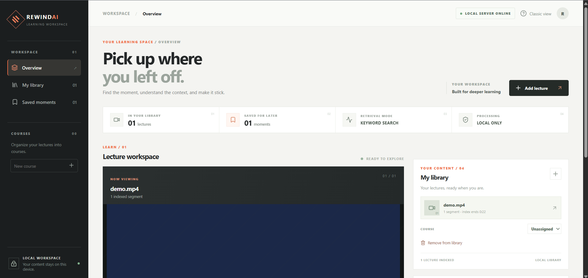
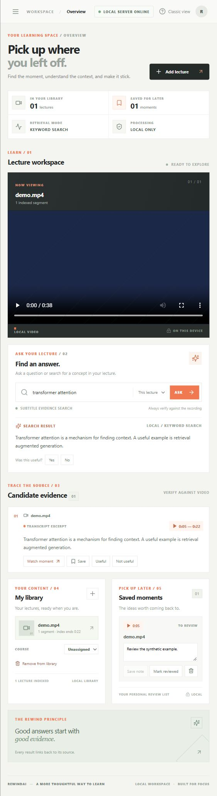

# 回课 AI（RewindAI）

[English](README.md) | **中文**

**找到知识，回看证据，学得更透。**

我开发了回课 AI（RewindAI），这是一个本地课程视频学习工作台。我使用 Qwen3-Embedding 进行语义检索，并结合时间戳证据、原视频回看和片段笔记，支持课程内容的查找与复习。

> **项目状态**：本项目处于开发和验证阶段。CPU 演示使用预设文本与简化检索，不代表真实视频识别或模型效果；完整多模态流程需独立安装模型、准备视频并完成评测。仅适合本地使用，不要直接部署到公网。



*截图使用合成演示内容，仓库不包含课程录像。*

<details>
<summary>查看窄屏工作台截图</summary>



</details>

## Windows 快速开始

需要 Windows 10/11、Python 3.11 或更高版本、Node.js/npm、Git、初次安装时的网络连接以及数 GB 可用空间。两个主要模型合计约 2.7 GB，依赖、可选转录模型和用户视频还需要额外空间。默认启动方式使用 CPU，加载和生成回答可能需要一些时间。

1. 在 PowerShell 中运行：

   ```powershell
   git clone https://github.com/laizhen1/RewindAI.git
   cd RewindAI
   python -m venv .venv
   .\.venv\Scripts\Activate.ps1
   python -m pip install --only-binary=:all: "llama-cpp-python>=0.3.36,<0.4" --extra-index-url https://abetlen.github.io/llama-cpp-python/whl/cpu
   python -m pip install -e ".[asr,qwen-semantic]" huggingface-hub
   cd frontend
   npm ci
   npm run build
   cd ..
   ```

   如果找不到 `python`，请从 [python.org](https://www.python.org/downloads/) 安装 Python 并启用 PATH 选项，然后重新打开 PowerShell。如果 PowerShell 禁止激活脚本，可将后续 `python` 替换为 `.\.venv\Scripts\python.exe`。第一条 pip 命令获取官方预编译 CPU wheel；如果平台没有兼容版本，命令会报错而不会自动编译。此时请参考上游[安装说明](https://github.com/abetlen/llama-cpp-python#installation)选择兼容版本或配置 C++ 编译环境。

2. 下载公开预训练模型；第三条仅在需要为无时间戳字幕的视频自动转录时需要：

   ```powershell
   python scripts/setup_qwen_embedding.py
   python scripts/setup_answer_model.py
   python scripts/setup_whisper_model.py
   ```

   下载的是公开模型，不是课程录像。Qwen3 负责检索，Qwen2.5 负责生成回答；导入视频只建立索引，不会训练模型。

3. 在项目文件夹运行 `Start-RewindAI-React.cmd`，保持窗口打开，然后访问 **http://127.0.0.1:5000/**。点击 **Add lecture**，选择有权使用的视频和可选 SRT/VTT 字幕，确认使用权限与本机存储。等待索引或转录完成后即可提问，并点击时间戳回看。

   如果显示旧界面，请在 `frontend` 重新运行 `npm run build` 并重启。如果提示缺少模型，请重新运行对应下载命令；添加 `--check-only` 可离线检查缓存。如果 5000 端口被占用，请关闭占用该端口的服务，或参考[完整指南](docs/REACT_WORKSPACE.md)手动启动。

浏览器仅将文件发送给本机 RewindAI 服务。视频副本和衍生数据保存在本机，移除资料库条目不会删除这些文件。请确认课程所有者与学校允许处理录像；其他平台和隐私细节见[完整指南](docs/REACT_WORKSPACE.md)。

## 当前功能

- **课程管理：**组织课程与视频；删除课程时，视频和笔记会保留。
- 对视频资料提问，查看答案和证据；证据包含时间戳，可跳转到可用的视频文件。字幕模式可按需展开同一视频的前后字幕，作为未验证的上下文；安装 PyAV 后也可查看片段中点附近的一帧画面，画面仅供人工核验。
- 保存或删除片段收藏，编辑复习笔记，标记已复习或待复习，并按状态、视频名称或备注筛选；可将已保存的笔记、时间戳和状态导出为本地文本文件。

- 分别对回答和证据提交有用或需改进的反馈，并可填写原因；反馈保存在本地数据库。
- 区分演示模式和完整模式，避免把占位演示当作真实模型结果。
- 添加本地视频时展示处理状态与失败原因；成功后如列表刷新失败，会提示视频已保存，避免重复导入。
- **语义检索：**使用本地 Qwen3-Embedding 检索课程字幕，同时提供无需模型的关键词检索；两种模式均支持按时间戳回看。
- 支持语音、关键帧、混合检索、重排和人工评测，完整多模态模型流程仍需独立验证。

可使用可分享素材开展[五项任务的可用性测试](docs/USER_STUDY.md)；该文档是计划，不代表已完成用户研究。
[产品案例与演示提纲](docs/PORTFOLIO_CASE.md)说明用户流程、已有证据和仍需完成的验证。

页面保持打开时，收藏列表刷新不会丢失未保存的备注；请点击“保存备注”写入本地数据库。存在未保存或正在保存的备注时，浏览器可能在重新加载或关闭页面前提醒；浏览器也可能不显示提醒，页面关闭后草稿仍会丢失。导出前须保存所有正在编辑的备注；导出包含全部收藏，不受筛选条件影响。文件包含视频名称和备注，课程相关内容请保存到未同步云端的本机文件夹。

升级后首次启动时，旧收藏默认标为“待复习”，已有备注保留。复习状态只是个人清单，不代表片段或答案已被证明正确。

**当前限制：**网页不自动下载 Canvas 录像。在字幕模式下可输入本机视频和字幕路径来加载视频；视频路径、字幕副本、课程归属、收藏和笔记存储在本地数据库。重启时会恢复未被移动或修改的视频；如果视频丢失或改变，界面会提示恢复原文件，或移除失效的本地索引后重新导入；原视频和收藏笔记会保留，旧版片段收藏可能无法回看，需要重新收藏。如果证据开始时间超出视频时长，播放器会提示检查字幕与视频的匹配关系；该检查不能证明其他时间戳正确。视频变化在运行时及重启时通过文件大小和修改时间检测；受影响范围会停止检索和回放，避免旧证据指向变化后的文件。这并非内容完整性校验，已缓冲的播放器内容也可能继续播放。字幕副本不会自动随外部字幕文件更新；字幕模式可先选择视频并移除其本地索引，再重新加载更新后的字幕。原视频、原字幕和收藏备注不会删除；来自旧字幕的收藏可能无法回看。若使用命令行显式指定视频，重新运行相同启动命令会再次加载该视频。完整多模态模式需要预处理并建立索引。演示包未包含真实示例视频，播放器可能显示不可用。问答默认搜索全部索引，也可选择当前视频或当前视频所属课程；指定范围的搜索需要扫描完整索引，在大型数据集上可能较慢。服务仅接受本机 Host 和同源浏览器请求；没有账号、多用户隔离或生产级鉴权，远程使用需要本机 SSH 转发，不支持通过非本机域名直接访问。

字幕检索、实验性画面检索和画面预览在处理结束后会再次检查视频源；发现变化时不返回该结果。此检查无法发现文件大小与修改时间都保持不变的替换，也无法防止最终检查之后发生的变化。

## React 学习工作台

新版 React 工作台整合本地视频资料库、Qwen3 语义检索、时间戳证据与复习笔记。安装前端依赖、构建界面并准备预训练模型的步骤见 [React 工作台与隐私指南](docs/REACT_WORKSPACE.md)。Windows 用户完成准备后，可运行 `Start-RewindAI-React.cmd`，然后打开 `http://127.0.0.1:5000/`。

导入时请选择有权处理的视频，可同时提供 SRT/VTT 字幕，并确认使用权限和本机存储。没有字幕时，系统使用已缓存的 Whisper base 在本机转录。Qwen3 用于建立检索索引，导入视频不会训练模型。视频副本和衍生数据的存储、清理及限制见指南；原工作台的高级功能可通过 `/classic` 使用。

## 实验性本地 AI 回答

可选模式使用本机 `llama-cpp-python` 和已有 GGUF 模型，在 CPU 上根据检索到的字幕生成回答；推理不会联网。回答可能编造、误解字幕或受到字幕中指令的影响。片段编号对应提供给模型的顺序，但模型引用可能有误；检索片段和时间戳只是候选证据，请回看原视频核对；没有检索到内容不代表整部视频没有答案。模型返回提示词要求的固定拒答语句时，界面会将其与没有检索到候选区分；其他拒答措辞无法通过此方法识别。该模式只处理文本，不理解画面，尚未完成独立核验的课程测试。

按照 [llama-cpp-python 安装说明](https://github.com/abetlen/llama-cpp-python#installation)安装 CPU 版本并准备本地 GGUF 文件，然后运行：

```bash
python scripts/run_transcript.py --answer-model /path/to/model.gguf
```

准备固定版本的公开 Qwen2.5 回答模型（约 2.1 GB）时，先安装 `huggingface-hub`，然后运行 `python scripts/setup_answer_model.py`；Windows 用户也可在安装依赖后双击 `Download-Qwen-Answer.cmd`。脚本会校验模型哈希，附加 `--check-only` 可离线检查已有缓存。请单独查看[模型许可证](https://huggingface.co/Qwen/Qwen2.5-3B-Instruct-GGUF)。此步骤只下载公开权重，不上传课程资料。

Windows 用户也可运行 `Start-RewindAI-Semantic-Answers.cmd`，组合本地语义检索与本地回答，两者均为实验功能并在 CPU 推理；语义索引重建可能较慢。可通过 `REWINDAI_SEMANTIC_MODEL` 和 `REWINDAI_ANSWER_MODEL` 修改本地模型路径。

本地回答模式将问题限制为 1,000 字符以内，避免模型静默忽略问题后半部分。检索字幕超过模型片段长度时，证据卡片会同时显示完整字幕和模型实际收到的部分。字符数限制不能保证所有输入都在模型的 token 上下文范围内；如果上下文超限或回答被截断，工作台会提示，而不会把不完整的回答当作完整结果。

本地回答生成失败时，工作台会按相同范围重新检索，并在提示原因的同时展示仍可用的字幕候选，不会声称已经生成回答。如果检索本身也失败，则显示错误。

Windows 用户可运行 `Start-RewindAI-Local-Answers.cmd`，使用本地缓存的 Qwen2.5 3B Q4_K_M 模型；也可设置 `REWINDAI_ANSWER_MODEL` 指向其他本地模型。启动脚本不会下载权重。此前的探索性回答测试与限制保留在[本地回答评估](docs/LOCAL_ANSWER_EXPERIMENT.md)。

使用 Qwen3 检索和本地严格回答提示词，在此前已探索的 50 个公开字幕片段上，固定拒答语句代理指标 F1 为 **0.276**；25 个标为可回答的片段仅 4 个被该规则判为已作答。这不评估答案正确性，提示当前配置可能过于保守；详见[方法与计数](docs/LOCAL_ANSWER_EXPERIMENT.md#qwen3-retrieval-with-local-answer-generation)。

## 本地核对字幕

自动字幕可能有错误。可以在本机播放每条字幕对应的视频，手动修正文本并另存 SRT：

```bash
python scripts/review_subtitles.py --video /path/to/lecture.mp4 --subtitles /path/to/lecture.srt
```

在本机打开 `http://127.0.0.1:5096/`，搜索字幕、听录音并导出。新文件保存在 `artifacts/corrected_subtitles/`，不会覆盖原文件，也不会上传。可通过 `--alternative /path/to/transcript.txt` 加入无时间戳的 UTF-8 TXT 文稿作近似对照。可以筛选对齐后存在字词差异的片段；自动对齐可能错位或截断，差异不代表哪个版本正确；请听原视频确认。只有手动修改的字幕经过处理，其他字幕仍可能有错；工具不会修改时间戳。关闭后可将导出的 SRT 作为输入重新启动以继续核对。要在检索中使用修正，请在工作台选中已保存的视频，填写新 SRT 的路径，再选择“更新当前视频的字幕”。时间范围完全相同的收藏会保留；其他收藏的备注仍会保留，但可能无法回看。仅通过启动参数加载的视频需先加入本地库。输出转换为纯文本 SRT，请保留在本机。

要在本机评估字幕质量，逐条听录音、必要时修正文字，并只勾选已核对的片段；点击“计算已核对片段错误率”，工具会以你确认的文字为参考，统计替换、遗漏和多出词元。英文按单词、中文按字计算，忽略标点和大小写；每次最多选 200 条，按字幕片段分别计算。结果仅反映自行核对的片段，不代表整段视频或独立核验。可保存进度以便日后恢复；该私人草稿包含修正字幕文字，并绑定原视频和字幕。也可选择将不含字幕文字、但含片段编号和指纹的汇总保存到本机；两者都须保密。若希望将修正内容用于搜索，仍需单独导出修正 SRT；汇总本身不包含参考文字。

## 快速开始

运行 CPU 演示无需下载大模型，适合检查界面和交互：

```bash
python -m venv .venv
# Windows PowerShell：.\.venv\Scripts\Activate.ps1
# macOS/Linux：source .venv/bin/activate
python -m pip install -e ".[dev]"
python scripts/run_demo.py
```

在浏览器打开 `http://127.0.0.1:5000`。演示数据是两条预设片段，并非读取真实课堂视频。首次启动无真实视频文件时，视频播放和时间跳转无法展示实际画面。

在 Windows 上完成环境安装后，也可以双击 `Start-RewindAI-Demo.cmd` 启动演示，然后在浏览器打开上面的本机地址。关闭命令窗口即可停止服务。

测试与代码检查：

```bash
python -m pytest -q
python -m ruff check src/video_rag/api scripts/ingest_local.py tests/test_ingest_local.py tests/test_library_api.py
```

未安装 FAISS、PyAV 等可选依赖时，相关测试会跳过。轻量测试通过并不代表完整多模态模型流程已验证。

## 真实视频流程

### 使用已有字幕（低配置）

在 Windows 安装好环境后，双击 `Start-RewindAI-Workspace.cmd`，然后打开 `http://127.0.0.1:5000`；也可以运行 `python scripts/run_transcript.py`。无需在启动命令中指定视频：在网页左侧输入本机视频与字幕路径即可加载。之前通过网页添加且文件未发生改变的视频会从本地数据库恢复。还没有加载视频时，先添加视频再搜索。关闭启动窗口即可停止服务。

没有时间戳的 `.txt` 文稿无法可靠支持视频跳转，不能直接导入。请使用带时间戳的 SRT/VTT 字幕，或通过本地转录生成字幕；生成时间戳不代表内容准确，仍需对照原视频检查。

如果你有本地视频及其配套的 UTF-8 `.srt` 或 `.vtt` 字幕，可以在项目环境中运行：

```bash
python scripts/run_transcript.py --video /path/to/lecture.mp4 --subtitles /path/to/lecture.srt
```

要在字幕模式下查看命中片段的画面，可安装 `python -m pip install -e ".[asr]"`（包含 PyAV）；画面在本机按需解码，不上传，也不代表系统理解画面。

此模式无需下载模型、无需联网，适合资源有限的电脑。它只进行**关键词匹配和字幕原文摘录**，不是语音识别、AI 生成或视频画面理解；不会自行生成字幕，也不能保证跨语言语义检索。只能处理外置字幕文件。如果字幕不足以回答问题，应该回看视频核对。单独运行时默认打开 `http://127.0.0.1:5000`。

要同时学习多个本地视频，可以按相同顺序重复指定视频和字幕：

```bash
python scripts/run_transcript.py --video lecture1.mp4 --video lecture2.mp4 --subtitles lecture1.srt --subtitles lecture2.srt
```

也可以省略所有 `--subtitles`，程序会为每个视频寻找同名的 `.srt` 或 `.vtt` 文件。文件只在本机读取，加载后可以在网页中将视频归入课程并选择单视频搜索。

若视频没有字幕，安装 faster-whisper 并准备本地缓存模型后，可以在字幕工作台输入本地视频路径，选择语言并点击“本机转录并加载”；一次只能处理一个视频。也可以使用 [本地转字幕指南](docs/LOCAL_TRANSCRIPTION.md)中的命令行工具。Windows 用户完成安装并缓存模型后，可双击 `Start-RewindAI-Transcribe.cmd` 选择视频进行本地转录，再打开搜索界面；新视频会保存到本地资料库，以便下次恢复。已保存且未变化的视频会直接打开工作台，避免重复转录；替换字幕前须先移除旧索引。默认使用本地缓存和 CPU，不向云端上传视频或音频；首次获取模型需显式允许下载。转录已在两段公开短视频上使用本地模型验证；课程录制的效果仍需评估。

### Qwen3 语义搜索

先运行 `python -m pip install -e ".[qwen-semantic]" huggingface-hub` 安装依赖，再通过以下命令下载 [Qwen3-Embedding-0.6B GGUF](https://huggingface.co/Qwen/Qwen3-Embedding-0.6B-GGUF) 公开模型（639 MB）并校验固定版本的哈希：

```powershell
python scripts/setup_qwen_embedding.py
```

同一未修改的模型也可从 [RewindAI GitHub Release](https://github.com/laizhen1/RewindAI/releases/tag/qwen3-embedding-0.6b-q8) 下载，其中包含 Apache-2.0 许可证和 SHA-256 校验值。

Windows 用户安装依赖后也可双击 `Download-Qwen3-Embedding.cmd`。该步骤只获取公开模型，不上传课程资料；`python scripts/setup_qwen_embedding.py --check-only` 可离线检查缓存。`llama-cpp-python` 的安装可能需要 CPU wheel 或 C++ 编译环境，详见[安装说明](https://github.com/abetlen/llama-cpp-python#installation)。如果已手动下载模型，也可直接指定文件：

```powershell
python scripts/run_transcript.py --semantic-model PATH_TO_QWEN3_GGUF
```

Windows 用户可以双击 `Start-RewindAI-Semantic.cmd`；启动器默认查找项目缓存中的固定版本 `370f27d7550e0def9b39c1f16d3fbaa13aa67728`。也可设置 `REWINDAI_SEMANTIC_MODEL` 指向其他位置的 GGUF 文件。启动器不会下载模型。向量在本机 CPU 生成，使用最后一个 token 的池化向量，仅对查询添加检索指令，字幕输入截断为 512 个 token；查询连同检索指令超过此长度时，系统会提示缩短问题。内存中的有限缓存可在重建索引时复用未变化的字幕向量，并在召回和重排时复用最近的问题向量；进程退出后缓存清除，不会将字幕、问题或向量写入磁盘。0.4 相似度阈值尚未针对 Qwen3 校准，请回看视频核对证据。历史 MiniLM 结果会单独标注，不能作为 Qwen3 的结果。

在此前已探索的 YTCommentQA 公开视频字幕片段中，Qwen3 对 284 道题的**检索候选可回答性代理指标**为 Precision 0.847、Recall 0.919、F1 0.882；61 个标为无答案的片段中，37 个仍返回候选。这不是回答正确率或课程录像结果，详见[方法与计数](docs/INITIAL_EVALUATION.md#qwen3-single-model-snippet-proxy)。

Qwen3 对 151 道公开视频完整字幕问题的评测中，**108/151** 道题的前 3 个候选与参考时间范围重合；按时间重合计算的微平均 Precision / Recall / F1 为 **0.248 / 0.389 / 0.303**。这是时间定位指标，不是回答正确率；77 条字幕因格式异常被排除。详见[样本和限制](docs/INITIAL_EVALUATION.md#qwen3-complete-eligible-public-transcript-partition)。

### 实验性本地画面搜索

可选的 CLIP 画面检索在 CPU 上运行，按每个字幕片段中点抽取一帧，用英文描述查找相似画面。它与字幕检索分别运行，需已有视频和字幕；不生成回答，也不保证画面能回答问题。由于尚未校准无匹配阈值，**即使没有相关画面也会返回候选**，必须点击画面和原视频核对。可搜索全部视频、当前视频或当前视频所属课程，每次最多搜索 100 个片段的中点画面；范围更大时会在各视频中均匀抽样并提示可能遗漏，范围超过 100 个视频时需要缩小。首次搜索、切换范围及视频库变化后可能需要重新索引。

“实验性融合检索”使用 RRF（k=60）合并字幕和采样画面的候选排名，并标注来源；它不生成回答，也不能证明画面与问题相关。画面检索失败时会提示并保留字幕候选。Windows 用户可运行 `Start-RewindAI-Visual-Answers.cmd` 加载三个本地 CPU 模型；普通 AI 回答仍只基于字幕，融合检索只展示待核对片段。

[画面搜索实验指南](docs/LOCAL_VISUAL_EXPERIMENT.md)还介绍如何在同一批开发或验证题上，本机对比纯字幕与融合候选的时间定位。该对照不评估画面是否相关或答案是否正确；课程题目和评测结果必须留在本机。

安装 `python -m pip install -e ".[semantic]" "av>=11,<17"`，并将 [Xenova/clip-vit-base-patch32](https://huggingface.co/Xenova/clip-vit-base-patch32) 的 `tokenizer.json` 与 `onnx/model_quantized.onnx` 下载到本机模型目录（模型文件约 154 MB，遵循模型自身许可）。然后运行：

```powershell
python scripts/run_transcript.py --visual-model PATH_TO_LOCAL_CLIP_MODEL
```

Windows 用户准备好模型后，也可双击 `Start-RewindAI-Visual.cmd`。它默认查找项目本地缓存中的固定版本 `d15189d7028b43f1d3e65039190477f6af591c2a`；如使用其他目录，先设置 `REWINDAI_VISUAL_MODEL_DIR`。启动器本身不会下载模型。

打开本机工作台并加载已授权的视频和字幕，输入英文画面描述，点击“实验性画面搜索”。也可以选择“对照字幕与画面”，一次检索并分别查看字幕候选与画面候选；它不融合分数或生成多模态回答。若画面索引失败，字幕结果仍会显示。视觉索引、查询和帧处理都在本机 CPU 进行；代码不会上传课程视频。不要把私人截图、索引、字幕或模型输入提交到 GitHub。可在本地网页逐帧标注正例与无匹配问题，再计算采样帧级指标。详细模型版本、标注流程、已知限制和公开视频验证见 [画面搜索实验](docs/LOCAL_VISUAL_EXPERIMENT.md)。

### 使用完整多模态模型

完整流程涉及视频预处理、构建索引和启动真实服务。推荐 Ubuntu 22.04、Python 3.11+、FFmpeg、24 GB 以上 NVIDIA 显存、64 GB 内存与 100 GB 磁盘；具体资源取决于视频和模型配置。请先阅读 [本地视频导入指南](docs/LOCAL_VIDEO_IMPORT.md) 和 `config.toml`，再根据自己的设备验证。模型权重和依赖的首次获取可能需要联网。

安装好模型依赖、FFmpeg 并准备好本地缓存后，可处理已有授权的视频文件或文件夹：

```bash
python scripts/ingest_local.py /path/to/authorized-video.mp4 --language en
```

该命令依次调用预处理和索引脚本，将结果保存到新的 `artifacts/ingestions/` 子目录，不复制原视频。默认启用模型中心离线模式；模型不在本地时需要显式允许下载。命令输出真实服务启动示例。此流程尚未在真实模型与课程视频上端到端验证。

本项目区分**本地索引**和**模型训练**：提取片段并建立检索索引通常不会改变模型权重。使用任何课程视频或个人资料前，请确认你有权使用。课程录像、转录、索引、问题、收藏、反馈及包含课程内容的评估结果应保留在本地，不上传 GitHub、云模型或其他第三方。`.gitignore` 排除了常见媒体、字幕、数据库和 `artifacts/`、`local_data/`，但不能识别散落在其他位置或改名后的所有私人内容；发布前仍须检查。

## 系统流程

```text
视频 → 语音转录与关键帧 / 画面描述
     → 带时间戳的片段 → 混合检索 → 重排
问题 ───────────────────────────────┘
     → 基于证据的回答与时间戳 → 回看与收藏
```

CPU 演示仅使用模拟片段、词汇检索和简单回答拼接；以上完整模型流程不代表已经验证过模型质量。

工作台复习清单中的“本地反馈记录”可以查看和删除最近 100 条反馈；本机服务运行时也可通过 `http://127.0.0.1:5000/api/feedback` 查看。记录包含问题、评价、原因、可选的证据片段 ID 与反馈来源（字幕、画面或整体结果）；旧版反馈保留为来源未知。页面按来源统计全部本地反馈，记录列表则只显示最近 100 条。反馈由用户自愿提交且可能重复，数量不是准确率、Precision、Recall 或 F1；评估模型仍需独立标注的测试集。反馈可能包含私人课程内容，不应公开或上传。

本地证据标注页面可以一边看视频、一边记录问题及时间范围，输出为私人 CSV 草稿；使用方式和限制见[课程视频评估与人工标注方案](docs/REWINDAI_EVALUATION_ZH.md)。保存并不证明标签已独立核验，CSV 和来源绑定文件不得上传。

回答复核页会区分新草稿中模型实际收到的截取文字与完整字幕；旧草稿不会假称已记录模型输入。回答复核页支持“保存进度”和“恢复已保存的进度”。重新启动时，可用 `python scripts/resume_answer_review.py --video 本地视频路径`，恢复同一视频最近更新的开发或验证草稿或进度；课程题目、进度和结果均须留在本机。

标注页面配置本地 Qwen3 语义模型后，可对开发或验证草稿运行单模型时间证据诊断；结果不是回答准确率。测试集保留给独立评估。

可选择在本机逐题查看返回的时间范围并回看视频；逐题信息和截图可能包含私人课程内容，不能公开分享。

诊断可选保存本地汇总报告；报告和输入指纹仍属于私人数据，应保留在本机。

开发集可选浏览抽样字幕片段以寻找复习题起点，也可将抽样时间填入草稿；片段和时间不是已核验标签，字幕可能有误，仍需检查原视频并调整边界。

## 评估

上游候选问题集用于诊断，不是经过完整人工核验的正式金标准。不要把历史候选集中的结果写成经验证的准确率。课程视频测试应逐条核验答案和证据，按视频划分数据，分别检查语音、画面、综合和无答案问题。

此前 MiniLM 和关键词检索的探索结果保留在[评测历史](docs/INITIAL_EVALUATION.md)中；上文 Qwen3 结果使用不同模型，不能直接沿用旧数字。

画面检索仅完成公开短视频的五帧初步诊断；标签由助手拟定且未经独立核验，尚不能提供可靠的视觉 F1。课程录像的隐私数据、标注和评估细节保留在本机。方法、计数和限制见下列文档。

- [中文评估方案](docs/REWINDAI_EVALUATION_ZH.md)
- [初步实际评估、独立 TutorialVQA 字幕检索测试与可复现方法](docs/INITIAL_EVALUATION.md)
- [人工标注模板](data/evaluation/rewindai_annotation_template.csv)
- [实验记录模板](data/evaluation/rewindai_experiment_template.md)
- [完整产品和研发计划](docs/REWINDAI_PLAN_ZH.md)
- [可用于本地演示的公开教育视频及许可](docs/PUBLIC_SAMPLE_ZH.md)

## 许可证

本项目代码允许非商业用途的使用、修改和再分发，详见 [许可证](LICENSE)；商业用途需要另行取得书面许可。模型、数据集、视频和第三方依赖遵循各自的许可条款。

## 项目链接

- RewindAI: <https://github.com/laizhen1/RewindAI>
- Whisper: <https://github.com/openai/whisper>
- FAISS: <https://github.com/facebookresearch/faiss>
